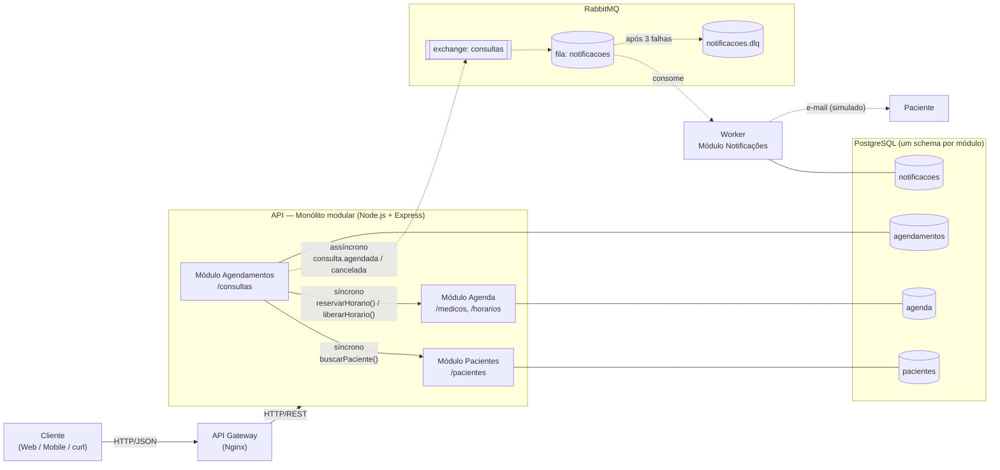
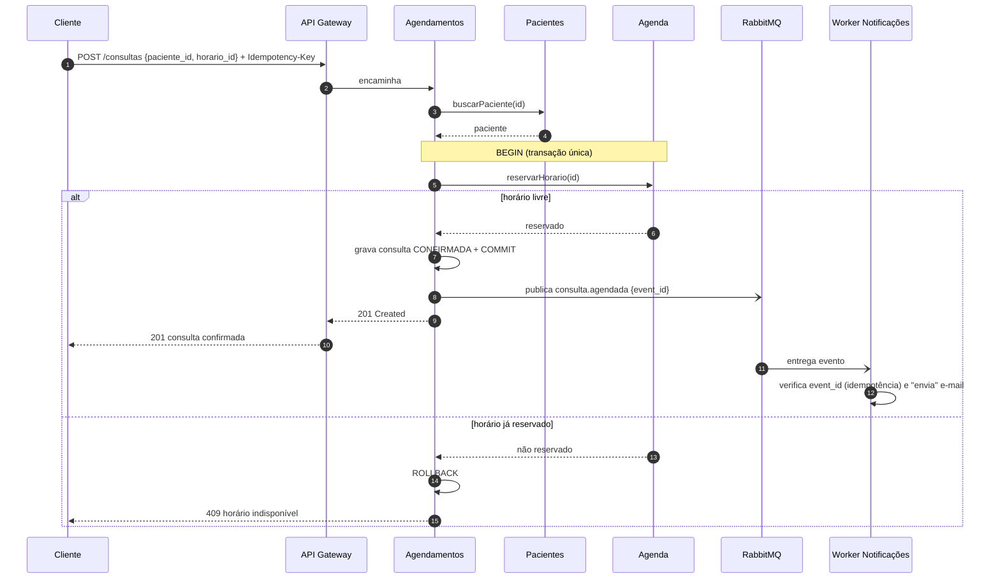

# CliniFlow — Proposta Arquitetural

**Cenário escolhido:** Sistema de agendamento de consultas.

O CliniFlow permite que pacientes se cadastrem, consultem os horários livres dos médicos,
agendem e cancelem consultas, e recebam notificações (e-mail simulado) sobre cada ação.

**Stack:** Node.js + Express, PostgreSQL, RabbitMQ, Nginx (API Gateway), Docker Compose.

---

## Etapa 1 — Identificação dos serviços

O sistema é um **monólito modular**: cada "serviço" abaixo é um **módulo** com fronteira bem
definida (rotas, regras e tabelas próprias). Os módulos só conversam pela **interface pública**
(`index.js`) uns dos outros, nunca acessando as tabelas alheias.

| # | Módulo | Responsabilidade | Dados que gerencia | Comunica-se com |
|---|--------|------------------|--------------------|-----------------|
| 1 | **Pacientes** | Cadastrar e consultar pacientes. | Schema `pacientes`: tabela `pacientes` (id, nome, email, telefone). | Recebe requisições REST do **Gateway**; é chamado (síncrono) pelo **Agendamentos**. |
| 2 | **Agenda** | Cadastrar médicos e seus horários; reservar e liberar horários. | Schema `agenda`: `medicos` (id, nome, especialidade), `horarios` (id, medico_id, data_hora, status `LIVRE`/`RESERVADO`). | Recebe requisições REST do **Gateway**; é chamado (síncrono) pelo **Agendamentos**. |
| 3 | **Agendamentos** | Marcar e cancelar consultas: valida o paciente, reserva o horário, registra a consulta e publica eventos. | Schema `agendamentos`: `consultas` (id, paciente_id, horario_id, status `CONFIRMADA`/`CANCELADA`, idempotency_key). | Chama **Pacientes** e **Agenda** (síncrono); publica eventos no **RabbitMQ** (`consulta.agendada`, `consulta.cancelada`). |
| 4 | **Notificações** | Consumir eventos e enviar e-mail ao paciente (simulado via log). Roda como **processo separado (worker)**. | Schema `notificacoes`: `notificacoes_enviadas` (event_id, tipo, destinatario, enviado_em) — usada para idempotência. | Consome eventos do **RabbitMQ** (assíncrono). Não expõe API pública. |

Componentes de infraestrutura:

| Componente | Papel |
|------------|-------|
| **API Gateway (Nginx)** | Ponto único de entrada; encaminha as requisições para a API e pode balancear entre réplicas. |
| **RabbitMQ** | Transporta eventos de forma assíncrona e durável; possui fila de mensagens mortas (DLQ). |
| **PostgreSQL** | Um único banco com **um schema por módulo** (`pacientes`, `agenda`, `agendamentos`, `notificacoes`). |

---

## Etapa 2 — Escolha dos estilos arquiteturais

### Monólito modular, microsserviços ou combinação?
**Monólito modular, com um worker separado para notificações.**

- O projeto é pequeno, com uma equipe só: microsserviços trariam custo operacional (vários deploys,
  rede entre serviços, consistência distribuída) sem benefício real neste porte.
- As fronteiras entre módulos são as mesmas que teríamos com microsserviços: cada módulo tem schema
  próprio e só se comunica pela interface pública. Se um módulo precisar escalar sozinho no futuro,
  ele pode ser **extraído para um microsserviço** sem reescrever o domínio.
- **Vantagem concreta:** reservar o horário e gravar a consulta acontecem na **mesma transação de
  banco**, eliminando a necessidade de compensação distribuída.
- A única parte separada é o **worker de Notificações** (mesmo código-fonte, outro processo), porque
  enviar e-mail é lento e não pode travar nem derrubar a API.

### REST ou SOAP?
**REST (HTTP + JSON).** É leve, amplamente suportado por front-ends web e mobile, fácil de testar
(curl/Postman) e não exige contratos WSDL. SOAP só se justificaria para integrar com sistemas
legados (ex.: um convênio que exija SOAP), o que não é o caso do MVP.

### Comunicação síncrona, assíncrona ou ambas?
**Ambas.**

| Tipo | Onde | Por quê |
|------|------|---------|
| **Síncrona (HTTP/REST)** | Cliente → Gateway → API. | O paciente precisa da resposta imediata: "consulta confirmada" ou "horário indisponível". |
| **Síncrona (chamada à interface do módulo)** | Agendamentos → Pacientes; Agendamentos → Agenda. | Validar o paciente e reservar o horário fazem parte da mesma operação e precisam de resposta na hora. |
| **Assíncrona (eventos via RabbitMQ)** | Agendamentos → RabbitMQ → worker de Notificações. | Enviar e-mail é lento e pode falhar; não deve bloquear nem derrubar o agendamento. |

### Precisa de API Gateway?
**Sim, um gateway leve (Nginx).** Mesmo com um monólito, ele oferece um único endereço para os
clientes, isola a API da internet e é o lugar natural para rate limiting, CORS, TLS e logs de
acesso. Também permite rodar **várias réplicas da API** atrás dele, e futuramente rotear para
módulos extraídos como microsserviços sem mudar o endereço usado pelos clientes.

### Service Mesh é justificável?
**Não.** Um Service Mesh (Istio, Linkerd) resolve problemas de comunicação entre dezenas ou centenas
de serviços: mTLS automático, observabilidade e políticas de tráfego entre eles. Num monólito
modular quase não há tráfego de rede entre serviços — os módulos se chamam dentro do mesmo processo.
O custo (sidecars, control plane, curva de aprendizado) não teria nenhum retorno.

---

## Etapa 3 — Tratamento de falhas

### 1. Um serviço ficar indisponível
- **API fora do ar:** o Docker reinicia o container (`restart: unless-stopped`) e o `GET /health`
  mostra o estado da aplicação. Com réplicas atrás do Nginx, o gateway desvia o tráfego para a
  instância saudável; sem nenhuma, ele responde **`502/503`**.
- **PostgreSQL fora do ar:** a API responde **`503 Service Unavailable`** com uma mensagem clara
  ("tente novamente em instantes") em vez de travar.
- **Worker de Notificações fora do ar:** nada quebra para o paciente. Os eventos ficam
  **armazenados na fila durável** do RabbitMQ e são processados quando o worker voltar.
- **RabbitMQ fora do ar:** a consulta continua sendo confirmada (o agendamento é o que importa); a
  falha ao publicar é registrada em log e a publicação é tentada novamente. Evolução: padrão
  **Transactional Outbox** para nunca perder o evento.

### 2. Uma resposta demorar além do tempo limite
- Cada requisição na API tem **timeout de 5 s**; estourado, a API responde **`504 Gateway Timeout`**.
- Consultas ao banco usam **`statement_timeout` de 2 s**, evitando que uma query lenta segure
  conexões.
- Como a reserva e a gravação da consulta estão na **mesma transação**, um timeout faz **rollback**
  das duas: não sobra horário "preso" sem consulta.
- No worker, o envio de e-mail tem timeout; se estourar, a mensagem é devolvida à fila para nova
  tentativa (ver item 4).

### 3. Uma mensagem for entregue mais de uma vez
- O RabbitMQ garante entrega *at-least-once*, então duplicatas são esperadas.
- Cada evento carrega um **`event_id` (UUID)**. O worker grava o `event_id` em
  `notificacoes_enviadas` (chave primária) e, se o id já existir, **descarta a mensagem** — o
  consumidor é **idempotente**.
- No lado HTTP, `POST /consultas` aceita o header **`Idempotency-Key`**: um reenvio do mesmo pedido
  devolve a consulta já criada em vez de criar outra.

### 4. Um evento não for processado
- O consumidor usa **ack manual**: só confirma a mensagem após processá-la com sucesso.
- Em caso de erro, a mensagem é reprocessada até **3 tentativas**; depois disso vai para a
  **Dead Letter Queue (`notificacoes.dlq`)**, onde pode ser inspecionada e reprocessada manualmente.

### 5. Dois usuários tentarem reservar o último horário disponível
(Equivalente, neste cenário, a "dois usuários comprando a última unidade de um produto".)

- A reserva é uma **atualização atômica condicional**, dentro da transação do agendamento:
  ```sql
  UPDATE agenda.horarios SET status = 'RESERVADO'
  WHERE id = $1 AND status = 'LIVRE';
  ```
- O banco garante que só **uma** das transações altera a linha. Se `linhas afetadas = 0`, o horário
  já foi tomado: a transação faz rollback e a API responde **`409 Conflict`** ("horário
  indisponível").
- Reforço: índice único parcial em `agendamentos.consultas (horario_id) WHERE status = 'CONFIRMADA'`.

---

## Etapa 4 — Diagrama arquitetural



Legenda: setas **contínuas** = comunicação síncrona; setas **tracejadas** = comunicação
assíncrona (eventos/fila).

### Fluxo principal — agendar consulta



---

## Endpoints previstos (MVP)

| Módulo | Método | Rota | Descrição |
|--------|--------|------|-----------|
| Pacientes | `POST` | `/pacientes` | Cadastra paciente |
| Pacientes | `GET` | `/pacientes/:id` | Busca paciente |
| Agenda | `POST` | `/medicos` | Cadastra médico |
| Agenda | `POST` | `/medicos/:id/horarios` | Cria horário livre |
| Agenda | `GET` | `/horarios?status=LIVRE` | Lista horários livres |
| Agendamentos | `POST` | `/consultas` | Agenda consulta (aceita `Idempotency-Key`) |
| Agendamentos | `DELETE` | `/consultas/:id` | Cancela consulta |
| Agendamentos | `GET` | `/consultas/:id` | Consulta status |
| — | `GET` | `/health` | Healthcheck (API + banco) |
