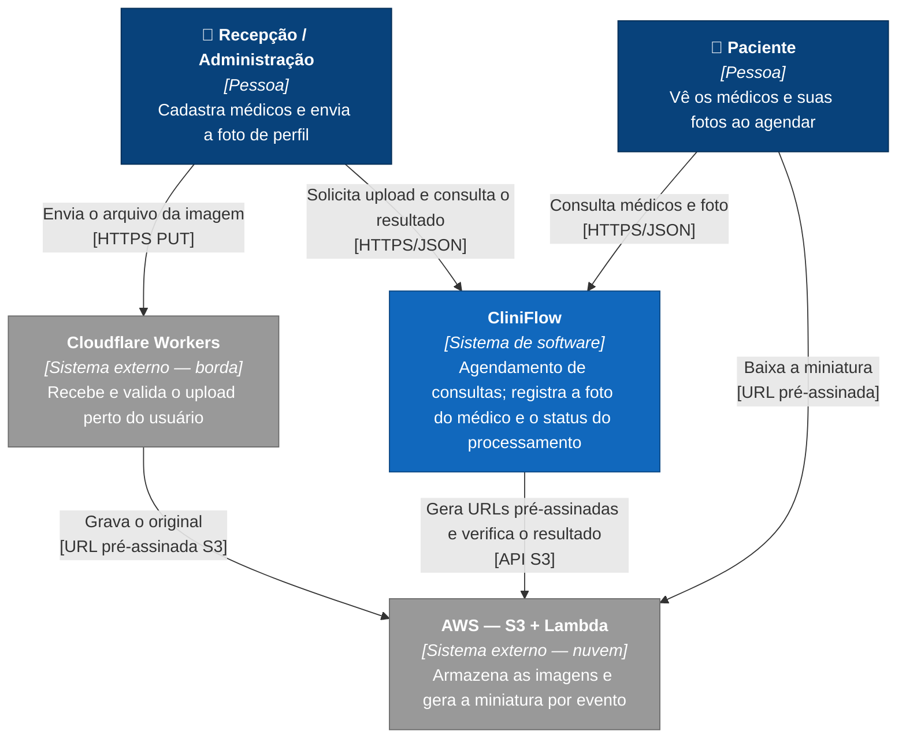
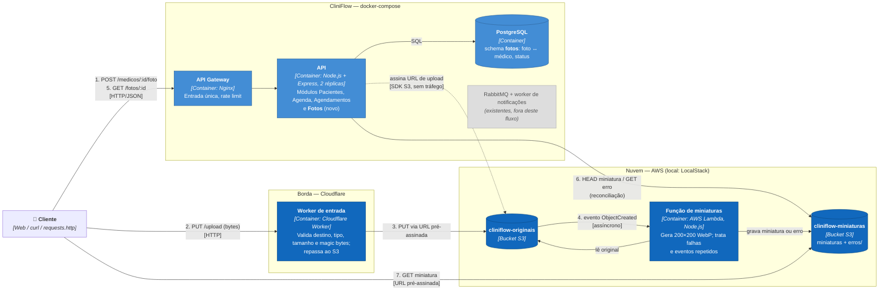
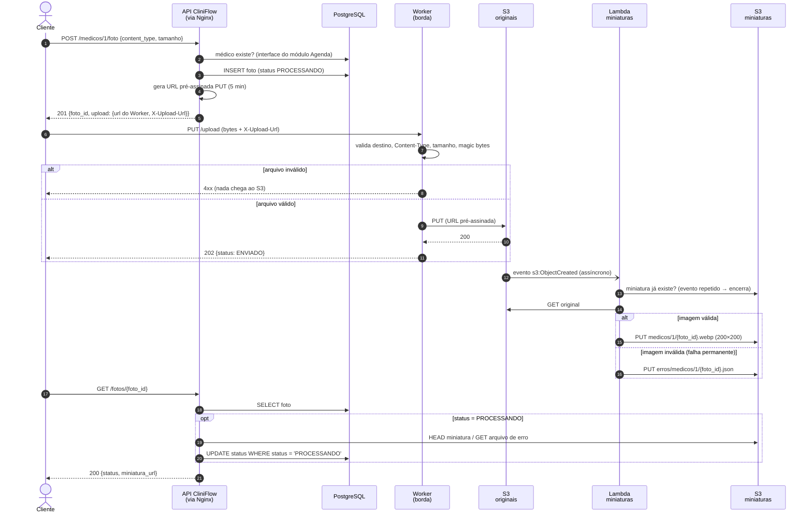

# CliniFlow — Arquitetura do pipeline de fotos (Serverless & Edge)

Prova de conceito do tema **Serverless & Edge Computing**, construída sobre o CliniFlow (veja
[`ARQUITETURA.md`](ARQUITETURA.md)). Caso de uso: a clínica envia a foto de perfil de um médico e
uma **miniatura é gerada automaticamente**, sem servidor próprio para isso. O CliniFlow guarda a
ligação entre a foto e o médico e expõe o resultado.

Os contratos detalhados estão em [`CONTRATOS.md`](CONTRATOS.md). Os diagramas seguem o
**modelo C4** (níveis 1 e 2, mais uma visão dinâmica), desenhados em Mermaid.

---

## 1. Contexto (C4 — nível 1)

---

## 2. Containers (C4 — nível 2)

**Execução local da PoC:** S3 e Lambda rodam no **LocalStack** (`http://localhost:4566`). O Worker
roda com **`wrangler dev`** (`http://localhost:8787`), usando o mesmo motor de execução da
Cloudflare (workerd). Em produção, só mudam os endereços e as credenciais (variáveis de ambiente,
§6 dos contratos).

---

## 3. Fluxo completo (C4 — visão dinâmica)

---

## 4. Decisões arquiteturais

| # | Decisão | Alternativas consideradas | Por que esta |
|---|---------|---------------------------|--------------|
| 1 | Novo módulo **`fotos`** com schema próprio, sem chave estrangeira para `agenda` | Colunas novas em `agenda.medicos` | Mantém a regra do CliniFlow: cada módulo é dono dos seus dados e conversa pela interface pública. Também permite guardar o histórico de envios. |
| 2 | **A API não recebe a imagem**: devolve uma URL pré-assinada, e o arquivo passa pelo **Worker** antes de ir ao S3 | (a) Upload pela API Express; (b) cliente direto no Worker sem passar pela API | (a) carregaria os bytes no servidor e deixaria a borda sem função. Em (b), o Worker não alcança a API local para registrar a foto. Na opção escolhida, a borda tem uma responsabilidade clara: validar e barrar arquivos ruins antes do armazenamento. |
| 3 | O Worker **não tem credenciais AWS** | Worker assina as requisições ao S3 com chave própria | Menor privilégio: a URL pré-assinada vale para uma única chave, por 5 minutos. Como a URL também poderia ser usada direto no S3, a Lambda repete a validação (defesa em profundidade). |
| 4 | **Dois buckets** (originais e miniaturas) | Um bucket com prefixos e filtro no gatilho | Gravar a miniatura nunca dispara a função de novo. Um erro de filtro de prefixo causaria um loop de invocações, e na nuvem real isso gera custo. |
| 5 | **Chave da miniatura sempre igual** para a mesma foto (`medicos/{medico}/{foto}.webp`) | Nome aleatório por execução | Torna o processamento idempotente: um evento repetido (o S3 entrega *at least once*) reescreve o mesmo objeto, e a Lambda ainda pula o trabalho se a miniatura já existe. |
| 6 | Status atualizado por **reconciliação sob demanda** na API | Lambda chama a API de volta; Lambda → SQS → CliniFlow | A API local não é acessível da nuvem, e um túnel (ngrok) é frágil para a demonstração. A troca: o status só muda quando alguém consulta. SQS fica como evolução para produção. |
| 7 | Estados **`PROCESSANDO → CONCLUIDO \| ERRO`**, finais, com tempo limite de 5 min | Estado extra `AGUARDANDO_UPLOAD` | Segue os três estados pedidos. O tempo limite cobre upload abandonado, upload recusado na borda e falha da Lambda sem arquivo de erro. |
| 8 | Falha **permanente** grava erro e encerra; falha **transitória** lança exceção e usa as retentativas da Lambda | Retentar sempre | Retentar um arquivo corrompido só gasta invocações. Retentar uma falha de rede costuma resolver. |
| 9 | Ambiente da PoC: **LocalStack + `wrangler dev`** | AWS e Cloudflare reais; MinIO; tudo na Cloudflare (R2 + Queues) | Sem créditos AWS. O LocalStack reproduz o gatilho S3 → Lambda real, e o mesmo código vai para a AWS. O MinIO foi descontinuado (2025). Gerar a miniatura dentro de um Worker esbarra no limite de 10 ms de CPU do plano gratuito. |

---

## 5. Limitações conhecidas da PoC

- **Latência de borda não é medida de verdade:** com `wrangler dev`, o Worker roda na própria
  máquina. O ganho de latência da borda só aparece com o Worker publicado na Cloudflare. As
  medições não devem presumir esse ganho.
- **Cold start emulado:** o LocalStack roda a Lambda em containers locais. Os tempos de
  inicialização não representam os da AWS.
- **Status só atualiza na consulta** (decisão 6).
- **Dependência de conta no LocalStack:** quem for executar a PoC precisa de uma conta gratuita
  (plano Hobby) e do próprio `LOCALSTACK_AUTH_TOKEN`.
