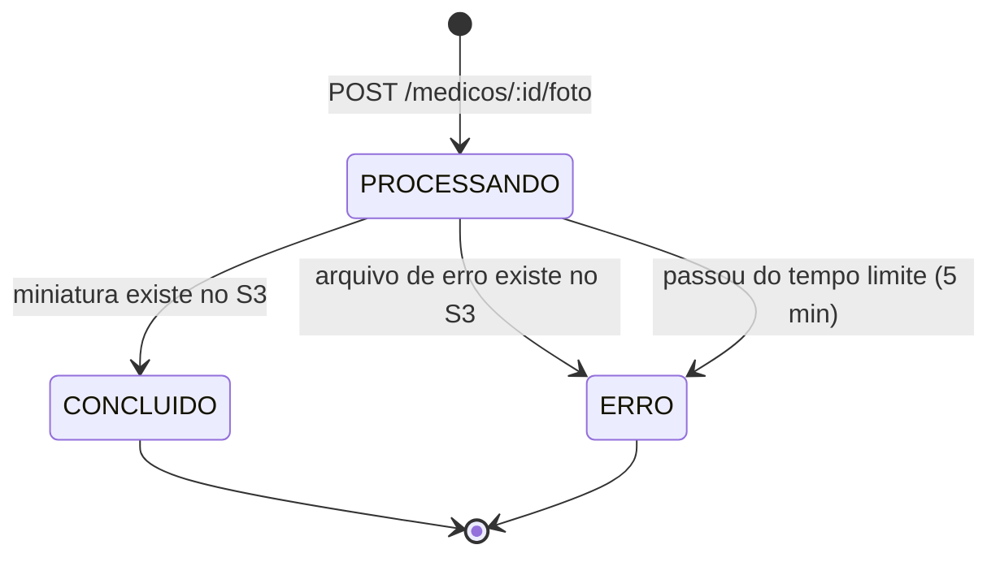

# CliniFlow — Contratos do pipeline de fotos (Serverless & Edge)

Contratos entre **API (CliniFlow)**, **Worker na borda (Cloudflare)**, **armazenamento (S3)** e
**função (AWS Lambda)**. Cada parte pode ser implementada separadamente, desde que respeite o que
está aqui. Mudanças neste documento devem ser combinadas com o grupo antes de entrar no código.

| Parte | Responsável | Contrato que precisa cumprir |
|-------|-------------|------------------------------|
| API (módulo `fotos`) | Integrante 1 | §2 (endpoints), §3 (estados), §6 (variáveis) |
| Lambda de miniaturas | Integrante 2 | §4 (buckets e chaves), §5 (função) |
| Worker de entrada + infraestrutura | Integrante 3 | §2.2 (upload no Worker), §4, §6 |
| Testes | Integrante 4 | Todos os cenários da §7 |

**Ambiente:** tudo roda localmente. S3 e Lambda rodam no **LocalStack** (plano Hobby, exige
`LOCALSTACK_AUTH_TOKEN` pessoal). O Worker roda com **`wrangler dev`**. A AWS e a Cloudflare reais
são o destino de produção. O código é o mesmo, só mudam as variáveis de ambiente.

---

## 1. Parâmetros fixos

| Parâmetro | Valor |
|-----------|-------|
| Formatos aceitos | `image/jpeg`, `image/png`, `image/webp` |
| Tamanho máximo do original | **5 MB** (5 242 880 bytes) |
| Miniatura | **200 × 200 px**, recorte central (*cover*), formato **WebP** |
| Validade da URL de upload | 5 minutos |
| Validade da URL de leitura da miniatura | 10 minutos |
| Tempo máximo de processamento | 5 minutos. Depois disso o status vira `ERRO` (ver §3) |
| Identificador da foto | UUID v4 (`foto_id`), gerado pela API |

Assinatura dos arquivos (*magic bytes*), usada pelo Worker e pela Lambda para conferir o tipo real:

| Tipo | Primeiros bytes |
|------|-----------------|
| JPEG | `FF D8 FF` |
| PNG | `89 50 4E 47 0D 0A 1A 0A` |
| WebP | `52 49 46 46` ("RIFF") nos bytes 0–3 e `57 45 42 50` ("WEBP") nos bytes 8–11 |

---

## 2. Endpoints

### 2.1 `POST /medicos/:id/foto` — solicitar upload (API, via Nginx `:8080`)

Registra a foto como `PROCESSANDO` e devolve as instruções de envio ao Worker. **A API não recebe
os bytes da imagem.**

Requisição:
```json
{ "content_type": "image/jpeg", "tamanho": 348120 }
```

Resposta `201 Created`:
```json
{
  "foto_id": "3f6c1e0a-8a51-4c43-9d0e-6a0f6f2b7c11",
  "medico_id": 1,
  "status": "PROCESSANDO",
  "upload": {
    "metodo": "PUT",
    "url": "http://localhost:8787/upload",
    "headers": {
      "Content-Type": "image/jpeg",
      "X-Upload-Url": "http://localhost:4566/cliniflow-originais/medicos/1/3f6c1e0a-....jpg?X-Amz-Algorithm=..."
    },
    "expira_em": "2026-11-11T14:05:00.000Z"
  },
  "consulta": "/fotos/3f6c1e0a-8a51-4c43-9d0e-6a0f6f2b7c11"
}
```

- `upload.url` é o endereço do Worker (`WORKER_URL`).
- `X-Upload-Url` é uma **URL pré-assinada S3 (PUT)** para a chave exata da foto no bucket de
  originais. Ela assina o `Content-Type`, então o arquivo precisa ser enviado com o mesmo tipo.

Erros:

| Status | Quando |
|--------|--------|
| `400` | `content_type` ou `tamanho` ausente, ou `tamanho` não é inteiro positivo |
| `404` | Médico não existe |
| `413` | `tamanho` > 5 MB |
| `415` | `content_type` fora da lista aceita |

### 2.2 `PUT /upload` — enviar o arquivo (Worker, `:8787` em dev)

Requisição: corpo binário da imagem, com os headers recebidos em `upload.headers`
(`Content-Type`, `X-Upload-Url`) e `Content-Length`.

O Worker, **nesta ordem**:
1. Confere se `X-Upload-Url` aponta para o endpoint S3 permitido (`S3_ALLOWED_ORIGIN`) **e** para
   o bucket de originais, na chave `medicos/{n}/{uuid}.{ext}`. Isso impede que o Worker seja usado
   como proxy aberto.
2. Confere o `Content-Type` e verifica se a extensão da chave combina com ele (`jpg`, `png` ou `webp`).
3. Recusa arquivos acima de 5 MB (pelo `Content-Length` e pelo tamanho real lido).
4. Confere os *magic bytes* (§1).
5. Faz `PUT` na URL pré-assinada com o mesmo corpo e o mesmo `Content-Type`.

Respostas:

| Status | Corpo | Quando |
|--------|-------|--------|
| `202 Accepted` | `{ "status": "ENVIADO", "chave": "medicos/1/<foto_id>.jpg" }` | Arquivo gravado no S3. O processamento acontece depois. |
| `400` | `{ "erro": "..." }` | Header faltando, URL malformada, extensão diferente do tipo |
| `403` | `{ "erro": "Destino de upload não permitido" }` ou `"URL de upload expirada"` | Falhou o passo 1, ou o S3 respondeu 403 |
| `413` | `{ "erro": "Arquivo maior que 5 MB" }` | Falhou o passo 3 |
| `415` | `{ "erro": "Conteúdo não é uma imagem JPEG/PNG/WebP" }` | Falhou o passo 2 ou o 4 |
| `502` | `{ "erro": "Armazenamento indisponível" }` | O S3 falhou ou não respondeu |

Arquivo recusado pelo Worker **não chega ao S3** e, portanto, não dispara a Lambda. Como o status
da foto não muda sozinho nesse caso, ela termina em `ERRO` por tempo limite (§3).

### 2.3 `GET /fotos/:foto_id` — consultar o resultado (API)

Resposta `200 OK`:
```json
{
  "foto_id": "3f6c1e0a-8a51-4c43-9d0e-6a0f6f2b7c11",
  "medico_id": 1,
  "status": "CONCLUIDO",
  "miniatura_url": "http://localhost:4566/cliniflow-miniaturas/medicos/1/3f6c1e0a-....webp?X-Amz-...",
  "erro": null,
  "criado_em": "2026-11-11T14:00:00.000Z",
  "atualizado_em": "2026-11-11T14:00:03.512Z"
}
```

- `miniatura_url` é uma URL pré-assinada de leitura (GET). Só vem preenchida em `CONCLUIDO`.
- `erro` é o motivo legível. Só vem preenchido em `ERRO`.

Erros: `400` (id não é UUID) e `404` (foto não existe).

### 2.4 `GET /medicos/:id/foto` — foto atual do médico (API)

Devolve a foto `CONCLUIDO` mais recente do médico, no mesmo formato da §2.3. Antes de escolher,
a API reconcilia as fotos do médico que ainda estão `PROCESSANDO` (§3).

Erros: `404` "Médico não encontrado" ou `404` "Médico sem foto processada".

---

## 3. Estados da foto



**A Lambda não acessa o banco do CliniFlow.** Quem atualiza o status é a API, por
**reconciliação sob demanda**: ao consultar uma foto em `PROCESSANDO`, a API verifica o S3 nesta
ordem:

1. `HEAD` da miniatura no bucket de miniaturas. Se existe, o status vira **`CONCLUIDO`**. A
   miniatura tem prioridade sobre o erro.
2. `GET` do arquivo de erro (§4). Se existe, o status vira **`ERRO`** com o `motivo` do arquivo.
3. Nenhum dos dois e `criado_em` há mais de `FOTO_TIMEOUT_SEGUNDOS`: o status vira **`ERRO`**
   ("Tempo limite de processamento excedido"). Cobre um upload que nunca aconteceu ou foi recusado
   pelo Worker, e uma Lambda que falhou sem conseguir gravar o arquivo de erro.
4. Caso contrário, continua `PROCESSANDO`.

Regras:
- Atualização atômica: `UPDATE ... WHERE id = $1 AND status = 'PROCESSANDO'`. Duas consultas ao
  mesmo tempo não geram resultados diferentes.
- `CONCLUIDO` e `ERRO` são **finais**. Uma miniatura que aparecer depois do tempo limite não muda o
  status, e é preciso enviar a foto de novo.
- Se o S3 estiver fora do ar durante a reconciliação, a API devolve o status que está no banco e
  **não** aplica o tempo limite, para não marcar `ERRO` por falha da própria API.

**Por que reconciliação e não um aviso da Lambda para a API?** A API roda localmente (Docker) e
não é acessível a partir da nuvem. A troca: o status só é atualizado quando alguém consulta, e cada
consulta pendente custa uma ida ao S3. Como evolução para produção, a Lambda poderia publicar o
resultado numa fila (SQS), consumida pelo CliniFlow como já é feito com o RabbitMQ nas
notificações.

---

## 4. Armazenamento (buckets e chaves)

Há **dois buckets separados** para que gravar a miniatura nunca dispare a função de novo (sem
risco de loop por erro de filtro de prefixo).

| Bucket | Conteúdo | Quem grava | Quem lê |
|--------|----------|------------|---------|
| `cliniflow-originais` | Fotos enviadas | Worker (via URL pré-assinada) | Lambda |
| `cliniflow-miniaturas` | Miniaturas e arquivos de erro | Lambda | API (HEAD/GET) e cliente (URL pré-assinada) |

Chaves, todas derivadas de `medico_id` e `foto_id`:

| Objeto | Bucket | Chave | Content-Type |
|--------|--------|-------|--------------|
| Original | `cliniflow-originais` | `medicos/{medico_id}/{foto_id}.{jpg\|png\|webp}` | o do upload |
| Miniatura | `cliniflow-miniaturas` | `medicos/{medico_id}/{foto_id}.webp` | `image/webp` |
| Erro | `cliniflow-miniaturas` | `erros/medicos/{medico_id}/{foto_id}.json` | `application/json` |

Expressão para extrair os ids da chave do original:
```
^medicos/(\d+)/([0-9a-f]{8}-[0-9a-f]{4}-[0-9a-f]{4}-[0-9a-f]{4}-[0-9a-f]{12})\.(jpg|png|webp)$
```

Conteúdo do arquivo de erro:
```json
{
  "foto_id": "3f6c1e0a-8a51-4c43-9d0e-6a0f6f2b7c11",
  "medico_id": 1,
  "chave_original": "medicos/1/3f6c1e0a-....jpg",
  "motivo": "ARQUIVO_INVALIDO",
  "detalhe": "Não foi possível decodificar a imagem",
  "ocorrido_em": "2026-11-11T14:00:02.100Z"
}
```

Valores de `motivo`: `ARQUIVO_INVALIDO`, `FORMATO_NAO_SUPORTADO`, `ARQUIVO_MUITO_GRANDE`,
`FALHA_PROCESSAMENTO`.

**Permissões mínimas** (menor privilégio, para configurar e citar no relatório):

| Quem | Permissão |
|------|-----------|
| API | `s3:PutObject` em `cliniflow-originais/medicos/*` (para assinar a URL); `s3:GetObject` em `cliniflow-miniaturas/*` (inclui o HEAD) |
| Lambda | `s3:GetObject` em `cliniflow-originais/*`; `s3:PutObject` e `s3:GetObject` em `cliniflow-miniaturas/*` |
| Worker | Nenhuma credencial AWS. Só usa a URL pré-assinada recebida. |

---

## 5. Função de miniaturas (Lambda)

**Gatilho:** notificação `s3:ObjectCreated:*` do bucket `cliniflow-originais`, prefixo `medicos/`.
Invocação assíncrona.

Para cada registro do evento:
1. Decodificar a chave (`decodeURIComponent`, trocando `+` por espaço) e extrair `medico_id` e
   `foto_id` pela expressão da §4. **Se a chave não casar:** registrar em log e ignorar. Sem os ids,
   não há onde gravar o erro.
2. **Eventos repetidos:** se a miniatura (§4) já existir, registrar "já processada" em log e
   encerrar com sucesso. Como a chave da miniatura é sempre a mesma para a mesma foto, reprocessar
   por engano apenas sobrescreveria o mesmo arquivo, sem duplicar nada.
3. Ler o original e validar o tamanho (≤ 5 MB) e os *magic bytes*. Esta validação repete a do
   Worker de propósito, porque a URL pré-assinada poderia ser usada direto no S3 sem passar pelo
   Worker.
4. Gerar a miniatura 200×200 WebP (§1) e gravá-la com `Content-Type: image/webp`.

Tratamento de falhas:

| Tipo de falha | Exemplo | O que a Lambda faz |
|---------------|---------|--------------------|
| **Permanente** (tentar de novo não resolve) | Arquivo corrompido, tipo errado, grande demais | Grava o arquivo de erro (§4) e **termina com sucesso**, para não haver retentativas inúteis |
| **Transitória** | Timeout ou erro 5xx do S3 | **Lança a exceção**, e a Lambda faz as retentativas automáticas da invocação assíncrona. Se todas falharem, a API marca `ERRO` pelo tempo limite. |

A Lambda **não** grava o arquivo de erro se a miniatura já existir.

Detalhes como biblioteca de imagem, memória, timeout da função, limite de dimensões em pixels e
destino para eventos que falharam ficam a critério do Integrante 2, desde que este contrato seja
respeitado.

---

## 6. Variáveis de ambiente

**API** (`docker-compose`, serviço `api`):

| Variável | Valor local | Observação |
|----------|-------------|------------|
| `S3_ENDPOINT` | `http://localstack:4566` | Usado pela API dentro da rede Docker (HEAD/GET) |
| `S3_PUBLIC_ENDPOINT` | `http://localhost:4566` | Usado para **gerar as URLs pré-assinadas**. A assinatura inclui o host, então ele precisa ser o endereço que o Worker e o cliente enxergam. |
| `AWS_REGION` | `us-east-1` | |
| `AWS_ACCESS_KEY_ID` / `AWS_SECRET_ACCESS_KEY` | `test` / `test` | Valores aceitos pelo LocalStack |
| `BUCKET_ORIGINAIS` | `cliniflow-originais` | |
| `BUCKET_MINIATURAS` | `cliniflow-miniaturas` | |
| `WORKER_URL` | `http://localhost:8787` | Endereço devolvido em `upload.url` |
| `FOTO_TIMEOUT_SEGUNDOS` | `300` | |

O LocalStack exige *path-style* (`forcePathStyle: true` no SDK).

**Worker** (`wrangler.toml` / `.dev.vars`):

| Variável | Valor local |
|----------|-------------|
| `S3_ALLOWED_ORIGIN` | `http://localhost:4566` |
| `BUCKET_ORIGINAIS` | `cliniflow-originais` |
| `MAX_BYTES` | `5242880` |

**LocalStack:** `LOCALSTACK_AUTH_TOKEN` no arquivo `.env`, que **não vai para o Git**. O repositório
traz um `.env.example` só com o nome da variável. Cada integrante usa o próprio token (conta
gratuita, plano Hobby).

O LocalStack também precisa de `S3_SKIP_SIGNATURE_VALIDATION=0`. Por padrão ele aceita URLs
pré-assinadas sem conferir a assinatura, e a AWS confere. Sem essa variável, um `Content-Type`
errado ou uma URL adulterada passariam no ambiente local.

---

## 7. Cenários que o contrato garante (base dos testes)

| # | Cenário | Resultado esperado |
|---|---------|--------------------|
| 1 | Imagem válida | Worker `202`; depois `GET /fotos/:id` → `CONCLUIDO` com `miniatura_url` 200×200 WebP |
| 2 | Tipo declarado inválido (`image/gif`) | API `415`, nada é registrado |
| 3 | Tamanho declarado > 5 MB | API `413` |
| 4 | Arquivo que não é imagem enviado como `image/jpeg` | Worker `415`, nada vai ao S3; foto termina `ERRO` por tempo limite |
| 5 | Arquivo inválido colocado direto no S3 (sem passar pelo Worker) | Lambda grava o arquivo de erro → `ERRO` com `ARQUIVO_INVALIDO` |
| 6 | `X-Upload-Url` apontando para outro host/bucket | Worker `403` |
| 7 | URL pré-assinada expirada | Worker `403` |
| 8 | Evento S3 repetido para a mesma foto | Lambda registra "já processada"; uma única miniatura, status inalterado |
| 9 | Duas consultas simultâneas a uma foto pendente | Mesmo status final; uma única atualização no banco |
| 10 | Médico inexistente | API `404` |
| 11 | S3 indisponível durante a consulta | API devolve o status salvo, sem marcar `ERRO` |
